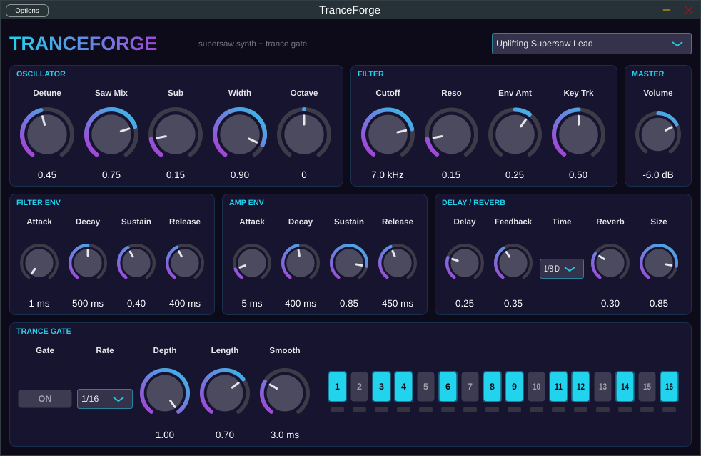

# TranceForge 🎹⚡

**פלאגין סינתיסייזר למוזיקת טראנס** – VST3 / AU / Standalone, כתוב ב-C++ עם [JUCE](https://juce.com).



A trance-focused synth plugin: 7-voice **supersaw**, resonant filter, a 16-step tempo-synced **trance gate**, ping-pong delay and reverb – all in one instrument.

---

## מה יש בפנים / Features

| חלק | תיאור |
|---|---|
| **Supersaw Oscillator** | 7 גלי מסור מכוונים-לא-מכוונים (anti-aliased PolyBLEP), שליטה ב-Detune, Saw Mix, פריסת סטריאו (Width), Sub-oscillator (סינוס אוקטבה מתחת), Octave ±2 |
| **Filter** | Low-pass רזוננטי (TPT State-Variable), Env Amount דו-כיווני, Key Tracking |
| **2 × ADSR** | מעטפת לפילטר ומעטפת לווליום |
| **Trance Gate** | 16 צעדים מסונכרנים לטמפו של ה-DAW, קצבים 1/8, 1/16, 1/32, 1/8T, 1/16T, עם Depth / Length / Smooth, ונורית שמראה את הצעד הנוכחי |
| **Ping-Pong Delay** | מסונכרן לטמפו (1/16 … 1/2 כולל dotted), feedback עם דעיכה כהה |
| **Reverb** | חלל גדול לליד ופאדים |
| **Master** | ווליום + soft-clipper למניעת קליפינג |
| **8 voices** | פוליפוני, תומך ב-pitch bend (±2) ו-velocity |

### Presets מובנים
1. **Uplifting Supersaw Lead** – הליד הקלאסי של uplifting trance
2. **Gated Trance Pad** – פאד עם trance gate בדפוס `x.xx.x.xx.xx.x.x`
3. **Psy Pluck** – פלאק פסיכדלי עם פילטר מהיר ו-delay
4. **Rolling Bass** – בס מתגלגל (off-beat) בעזרת ה-gate
5. **Hands Up Stab** – סטאב רחב לאקורדים

> ה-gate וה-delay מסתנכרנים אוטומטית לטמפו של ה-DAW. כשאין טרנספורט פועל (למשל ב-Standalone) הם רצים על 138 BPM.

---

## בנייה / Building

דרישות: **CMake 3.22+** וקומפיילר C++17 (Visual Studio 2022 / Xcode / GCC / Clang). JUCE יורד אוטומטית בזמן ה-configure.

```bash
cmake -B build -DCMAKE_BUILD_TYPE=Release
cmake --build build --config Release
```

הקבצים ייווצרו ב:
```
build/TranceForge_artefacts/Release/VST3/TranceForge.vst3
build/TranceForge_artefacts/Release/AU/TranceForge.component   (macOS בלבד)
build/TranceForge_artefacts/Release/Standalone/
```

**Linux** – צריך קודם:
```bash
sudo apt install libasound2-dev libfreetype-dev libfontconfig1-dev libx11-dev \
  libxrandr-dev libxinerama-dev libxcursor-dev libxext-dev libxcomposite-dev
```

### הורדה מוכנה בלי לקמפל
בכל push, GitHub Actions בונה את הפלאגין ל-Windows, macOS ו-Linux.
היכנס ל-**Actions → Build TranceForge → הריצה האחרונה → Artifacts** והורד את הגרסה למערכת שלך.

### התקנה
העתק את `TranceForge.vst3` לתיקיית ה-VST3:
- **Windows:** `C:\Program Files\Common Files\VST3\`
- **macOS:** `~/Library/Audio/Plug-Ins/VST3/` (ו-`TranceForge.component` ל-`~/Library/Audio/Plug-Ins/Components/`)
- **Linux:** `~/.vst3/`

ואז בצע rescan של הפלאגינים ב-DAW (Ableton, FL Studio, Cubase, Bitwig, Reaper…).

---

## מבנה הקוד / Code layout

```
Source/
  SupersawVoice.h      – הקול: 7 מסורים + sub + פילטר SVF + 2 ADSR
  TranceFX.h           – Trance Gate + Ping-Pong Delay
  PluginProcessor.*    – פרמטרים, presets, שרשרת האודיו, סנכרון טמפו
  PluginEditor.*       – הממשק הגרפי (נושא כהה/ניאון)
```

שרשרת האודיו: `Synth (8 voices) → Trance Gate → Ping-Pong Delay → Reverb → Master + Soft Clip`

ה-gate נמצא *לפני* האפקטים, כך שההדים וה-reverb "נושמים" עם הריתם – בדיוק כמו בטראנס.
